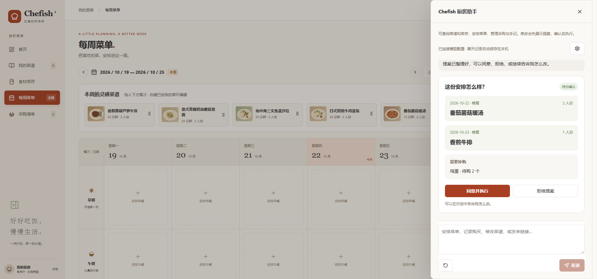

# Chefish

**菜谱、食材、一周菜单，都放在这里。**

Chefish 是一款 Windows 厨房管理应用。把喜欢的菜谱收进自己的菜谱库，看看冰箱里有什么，排好这周吃什么，再带着采购清单去买菜。厨房助手也能帮你找菜、整理做法、安排菜单和更新库存。

**目前主要面向中文用户，应用界面和 AI 助手以中文为主。**

[下载 v1.0.0](https://github.com/whitefi2h/Chefish/releases/tag/v1.0.0) · [English](#english) · [开发文档](docs/README.md)



*菜单与 AI 提案界面，使用演示数据。*

## 收藏想做的菜

看到下厨房里喜欢的做法，贴入链接就能整理成菜谱，连同封面、步骤图和原作者信息一起保存。也可以自己写菜谱，或导入 JSON、网页 HTML。

菜谱可以分类、收藏，加入周灵感。人数一改，配料用量跟着调整。做过之后写几句手记，记下这次的火候、口味和下次想改的地方。配方修改会留下版本，旧做法随时能翻出来看。

## 记住冰箱里有什么

同一种食材可以按不同购买批次记录，各自保留数量、存放位置和到期日期。冷藏、冷冻、常温分开查看，快到期的食材会出现在首页提醒中。

盐、糖、生抽这些常备调料单独放在侧栏。缺了就点亮感叹号，补齐后再点一下；缺货调料会一起出现在采购提醒里。

## 排好一周，少想几次“今天吃什么”

把菜谱拖进周历，一餐可以安排多道菜，也能调整人数、移动到别的日子。周末想做得丰盛一点，工作日想省些时间，都可以提前排好。

采购清单会根据菜单用量和现有库存算出还缺什么。买菜时可以补记临时想买的东西，确认购买后直接入库。做好一餐，再确认实际用量，库存就会相应扣减。

## 让厨房助手帮忙

不用每次都找按钮，也可以直接说：

> 帮我找三种下厨房的番茄炒蛋做法。
>
> 把第二个整理进菜谱。
>
> 用现有菜谱安排周末晚餐，两个人，别重复。
>
> 蒜和鸡翅都买了，帮我勾掉。

助手能查询菜谱和库存、安排菜单、记录购买、修改配方、整理分类和手记。涉及修改时，它会先给出提案：看清菜名、日期、人数和补购内容，点同意就执行；不满意可以继续聊，让它改。

聊天记录自动保留，关掉窗口后还能接着说，也可以手动清除。模型支持 DeepSeek、OpenAI 和 Gemini，在助手设置里填入自己的 API 密钥和模型名称即可使用。DeepSeek 是目前主要开发和实测的服务。

## 下载与使用

在 [Releases](https://github.com/whitefi2h/Chefish/releases/tag/v1.0.0) 下载 Windows x64 安装包，运行后按提示安装。首次打开时菜谱库为空，可以先导入一道菜，或者把家里现有的食材记下来。

手动管理菜谱、库存和菜单不需要配置 AI。使用厨房助手时，相关对话和厨房信息会发送到你选择的模型服务；API 密钥保存在 Windows 凭据管理器。菜谱、库存和聊天记录保存在本机。

源码最新版本也支持可选账户与多设备同步：菜谱图片、库存和菜单可在同一账户的电脑间接续使用，断网后继续编辑，联网补传。首次连接需明确选择厨房，冲突会暂停并保留安全备份。操作见 [同步说明](docs/CLOUD_SYNC.md)；公开 v1.0.0 安装包尚未包含这些新增功能。

想了解后续计划，可以看 [路线图](docs/ROADMAP.md)。

## 从源码运行

需要 Windows、Node.js / npm、Rust MSVC 工具链、Visual Studio C++ Build Tools 和 WebView2。

```powershell
npm ci
npm run tauri dev
```

构建 Windows 安装包：

```powershell
npm run tauri build -- --bundles nsis
```

安装包输出到 `src-tauri/target/release/bundle/nsis/`。只看浏览器演示可运行 `npm run dev`；演示使用独立样例数据，刷新后重置。

技术栈：Tauri 2 · React · TypeScript · SQLite。

---

## English

**Your recipes, pantry and weekly meals, together.**

Chefish is a Windows app for keeping recipes, tracking groceries and planning meals. Save a dish you want to try, check what is already in the fridge, plan the week and take the shopping list with you. The kitchen assistant can help with each step.

**Chefish currently primarily serves Chinese-speaking users. The app interface and AI assistant are Chinese-first.**

[Download v1.0.0](https://github.com/whitefi2h/Chefish/releases/tag/v1.0.0)

### Keep your recipes

Import a Xiachufang link with its cover, step images and author details, write your own recipe, or import JSON and HTML. Organize recipes into categories, save favorites and adjust ingredient amounts by serving size.

Cooking notes give you a place to record what worked and what you would change next time. Recipe edits keep their history, so you can return to an earlier version.

### Know what is in the kitchen

Track separate batches of the same ingredient, including quantity, storage location and expiry date. The home screen highlights food that needs attention.

Common seasonings have their own sidebar. Tap the alert icon when something runs out and tap again after restocking. Missing seasonings appear in shopping reminders.

### Plan meals and shop for what is missing

Drag recipes onto the weekly calendar, add several dishes to a meal and adjust servings. The shopping list uses your plans and pantry stock to work out what you still need.

Add extra groceries as you shop. Confirming a purchase receives it into the pantry; completing a meal records actual consumption and updates stock.

### Ask the assistant

Search for recipes, organize a selected result, plan dinner, record purchases or edit your collection through conversation. Before changing anything, the assistant shows a proposal with the details. Approve it, reject it or explain what you want changed.

Chats are saved locally so you can pick up where you left off. DeepSeek, OpenAI and Gemini are supported through the assistant settings. Bring your own API key and model ID; DeepSeek is the primary development and live-tested provider.

### Get started

Download the Windows x64 installer from [Releases](https://github.com/whitefi2h/Chefish/releases/tag/v1.0.0), run it and follow the setup steps. Start by adding a recipe or recording what you already have at home.

Manual recipe, pantry and planning features work without AI. When using the assistant, relevant conversation and kitchen data are sent to your selected provider. API keys are stored in Windows Credential Manager; kitchen data and chat history stay on your computer.

### Build from source

On Windows, install Node.js / npm, Rust MSVC, Visual Studio C++ Build Tools and WebView2, then run:

```powershell
npm ci
npm run tauri dev
```

Build the installer with `npm run tauri build -- --bundles nsis`. Output goes to `src-tauri/target/release/bundle/nsis/`. For a browser demo with sample data, run `npm run dev`.

[Project docs](docs/README.md) · [Roadmap](docs/ROADMAP.md) · [Changelog](CHANGELOG.md)
